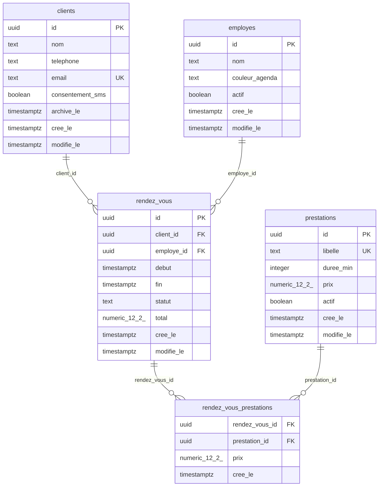

# Modèle de données

> Généré par `outils/schema-doc.js` (kit « Bases de données ») à partir de : `0001_init.sql`.

5 table(s) : `employes`, `clients`, `prestations`, `rendez_vous`, `rendez_vous_prestations`.

## `employes`

Personnes qui réalisent les prestations

| Colonne | Type | Obligatoire | Défaut | Unique | Lien (on delete) | Description |
| --- | --- | --- | --- | --- | --- | --- |
| `id` 🔑 | uuid | oui | gen_random_uuid() |  |  |  |
| `nom` | text | oui |  |  |  |  |
| `couleur_agenda` | text | oui | 'bleu' |  |  | Couleur de la colonne dans l'agenda |
| `actif` | boolean | oui | true |  |  |  |
| `cree_le` | timestamptz | oui | now() |  |  |  |
| `modifie_le` | timestamptz | oui | now() |  |  |  |

## `clients`

Clients du salon

| Colonne | Type | Obligatoire | Défaut | Unique | Lien (on delete) | Description |
| --- | --- | --- | --- | --- | --- | --- |
| `id` 🔑 | uuid | oui | gen_random_uuid() |  |  |  |
| `nom` | text | oui |  |  |  |  |
| `telephone` | text |  |  |  |  |  |
| `email` | text |  |  | oui |  |  |
| `consentement_sms` | boolean | oui | false |  |  | Accord du client pour les rappels par SMS (RGPD) |
| `archive_le` | timestamptz |  |  |  |  | Date d'archivage ; null = client actif |
| `cree_le` | timestamptz | oui | now() |  |  |  |
| `modifie_le` | timestamptz | oui | now() |  |  |  |

## `prestations`

Catalogue des prestations (coupe, couleur…)

| Colonne | Type | Obligatoire | Défaut | Unique | Lien (on delete) | Description |
| --- | --- | --- | --- | --- | --- | --- |
| `id` 🔑 | uuid | oui | gen_random_uuid() |  |  |  |
| `libelle` | text | oui |  | oui |  | Nom affiché au client et sur la facture |
| `duree_min` | integer | oui |  |  |  | Durée prévue en minutes |
| `prix` | numeric(12,2) | oui |  |  |  | Prix TTC en euros |
| `actif` | boolean | oui | true |  |  |  |
| `cree_le` | timestamptz | oui | now() |  |  |  |
| `modifie_le` | timestamptz | oui | now() |  |  |  |

## `rendez_vous`

Rendez-vous pris par les clients

| Colonne | Type | Obligatoire | Défaut | Unique | Lien (on delete) | Description |
| --- | --- | --- | --- | --- | --- | --- |
| `id` 🔑 | uuid | oui | gen_random_uuid() |  |  |  |
| `client_id` | uuid | oui |  |  | clients.id (restrict) |  |
| `employe_id` | uuid |  |  |  | employes.id (set null) |  |
| `debut` | timestamptz | oui |  |  |  | Début du rendez-vous |
| `fin` | timestamptz | oui |  |  |  | Fin calculée à partir des durées des prestations |
| `statut` | text | oui | 'prevu' |  |  | prevu, fait, annule ou absent |
| `total` | numeric(12,2) | oui | 0 |  |  | Total TTC recalculé côté serveur à partir des prestations |
| `cree_le` | timestamptz | oui | now() |  |  |  |
| `modifie_le` | timestamptz | oui | now() |  |  |  |

Index : `client_id`, `employe_id`, `debut`

## `rendez_vous_prestations`

Prestations de chaque rendez-vous (table de liaison)

| Colonne | Type | Obligatoire | Défaut | Unique | Lien (on delete) | Description |
| --- | --- | --- | --- | --- | --- | --- |
| `rendez_vous_id` | uuid | oui |  |  | rendez_vous.id (cascade) |  |
| `prestation_id` | uuid | oui |  |  | prestations.id (restrict) |  |
| `prix` | numeric(12,2) | oui |  |  |  | Prix TTC au moment du rendez-vous (le catalogue peut changer) |
| `cree_le` | timestamptz | oui | now() |  |  |  |

Index : `rendez_vous_id, prestation_id` (unique), `prestation_id`
